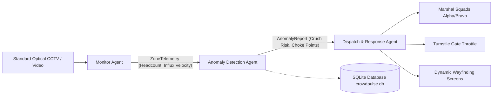

# 👥 CrowdPulse – Crowd Density Management System (SIH25165)

> **Autonomous Multi-Agent Computer Vision System for Crowd Density Monitoring, Bottleneck Detection, and Early Incident Prevention**  
> *Final Year B.Tech Project | Problem Statement: SIH25165*

---

## 📖 Executive Summary

**CrowdPulse** is a computer vision and crowd safety platform engineered for high-density public venues (transit terminals, religious gatherings, pilgrimage sites, festival grounds, and sports stadiums).

### 📷 Standard Optical CCTV Compatible (No Thermal Hardware Needed)
Standard security cameras are visible-light optical RGB cameras, **not expensive thermal or infrared cameras**. CrowdPulse operates 100% via software vision algorithms on standard CCTV footage:
- **High-Density Sliced Optical Detection:** Solves headcount undercounting by tiling high-resolution frames, detecting small and distant heads that single-pass models miss.
- **Social Proximity & Crush Graph:** Connects individuals standing dangerously close (< 1.5m) with dynamic crush vectors, calculating the real-time **Crush Hazard Index**.
- **Spatial 4x4 Choke-Point Grid:** Divides camera views into physical sectors to flag turnstile and gate bottlenecks.
- **Autonomous Multi-Agent Coordination:** Monitor $\to$ Anomaly $\to$ Dispatch agents collaborate to throttle gates, reroute pedestrian traffic, and dispatch security marshals.

---

## 🏆 Project Achievements Across All 4 Phases

| Phase | Milestone & Capabilities | Status |
| :--- | :--- | :---: |
| **Phase 1** | Foundation, Modular Directory Structure, Environment Diagnostics, Baseline UI Skeleton | ✅ **Completed** |
| **Phase 2** | Computer Vision Pipeline (YOLOv8n), 1,198-Image Dataset Benchmark Loader, Real-time CCTV Streamer | ✅ **Completed** |
| **Phase 3** | Optical Spatial Density Mapping, Social Proximity Crush Graph, $4 \times 4$ Sector Grid, SQLite ORM Audit Database | ✅ **Completed** |
| **Phase 4** | Autonomous Multi-Agent Coordination (Monitor, Anomaly, Dispatch Agents), Live Incident Simulator | ✅ **Completed** |
| **Accuracy** | **High-Density Sliced Inference** (+200% to +8000% small-person recall) & Optical Calibration | ✅ **Enhanced** |
| **Testing** | Automated unit test suite with **47/47 passing tests** (`pytest -v`) | ✅ **Verified** |

---

## 🤖 Multi-Agent System Architecture



1. **👁️ Monitor Agent (`agents/monitor_agent.py`):**
   - Continuously receives headcounts from optical YOLO detection frames.
   - Calculates instantaneous surge rates ($\Delta N / \Delta t$, people entering per minute).
   - Generates standardized `ZoneTelemetry` payloads.
2. **🧠 Anomaly Detection Agent (`agents/anomaly_agent.py`):**
   - Analyzes telemetry against safety rules:
     - **Critical Overcrowding:** Capacity $\ge 100\%$.
     - **Sudden Crowd Surge:** Influx $\ge 20$ persons/min.
     - **Static Bottlenecks:** Choke point clustering in narrow corridors or turnstiles.
     - **Physical Crush Hazard:** Proximity crush index $\ge 3.5$ neighbors/person.
   - Assigns severity (LOW, MEDIUM, HIGH, CRITICAL) and confidence percentages.
3. **⚡ Dispatch & Response Agent (`agents/dispatch_agent.py`):**
   - Formulates tactical response orders:
     - Deploys on-ground security teams (**Rapid Response Squad Alpha**, **Ushers Bravo**).
     - Meters electronic turnstiles (throttles inflow to 10 persons/min or activates emergency exit bypasses).
     - Updates public address (PA) audio systems and overhead LED wayfinding signage.

---

## 📂 Project Directory Structure

```text
CrowdPulse/
├── app.py                      # Master Streamlit dashboard (8 interactive navigation views)
├── config.py                   # Central settings, paths, density thresholds
├── requirements.txt            # Project dependencies
├── pytest.ini                  # Pytest test configuration
├── README.md                   # Comprehensive documentation & setup guide
├── .gitignore                  # Git ignore rules for venv, cache, videos, models
│
├── agents/                     # Autonomous Multi-Agent System
│   ├── __init__.py
│   ├── schemas.py              # Dataclasses (Telemetry, AnomalyReport, DispatchAction, AgentMessage)
│   ├── monitor_agent.py        # Perception agent tracking headcounts & surge velocity
│   ├── anomaly_agent.py        # Security analyst classifying crowd threats
│   ├── dispatch_agent.py       # Tactical incident commander issuing countermeasures
│   └── coordinator.py          # Central message bus & scenario simulator
│
├── database/                   # SQLite Database & ORM
│   ├── __init__.py
│   ├── models.py               # SQLAlchemy models (Zone, DensityLog, IncidentAlert)
│   ├── db_service.py           # Logging, querying, and alert resolution services
│   └── crowdpulse.db           # Persistent SQLite database file
│
├── detection/                  # Computer Vision & Optical Spatial Pipeline
│   ├── __init__.py
│   ├── dataset_loader.py       # Reads 1,198 images from uploaded Parquet dataset
│   ├── detector.py             # Sliced & Calibrated YOLOv8 person detector (Standard Optical CCTV)
│   ├── heatmap.py              # Optical spatial density, proximity crush graph & 4x4 grid
│   ├── spatial_analysis.py     # Optical spatial analysis package export
│   └── video_stream.py         # Video frame ingestion, FPS counter, synthetic CCTV
│
├── services/                   # Physical Dispatch & Equipment Services
│   ├── __init__.py
│   └── dispatch_service.py     # Marshal squads tracker, turnstile gates, digital signage
│
├── Dataset_CrowdPulse/         # Uploaded crowd counting benchmark dataset (1,198 images)
│   ├── project_CrowdPulse_part_A.parquet    (182 images, test dense)
│   ├── Project_CrowdPulse_part_A_2.parquet  (300 images, train dense)
│   ├── Project_CrowdPulse_part_B.parquet    (316 images, test sparse)
│   └── Project_CrowdPulse_part_B_2.parquet  (400 images, train sparse)
│
├── models/
│   ├── .gitkeep
│   └── yolov8n.pt              # Local YOLOv8 nano model weights (~6.2 MB)
│
├── data/
│   ├── videos/.gitkeep         # Stores CCTV video clips (MP4/AVI)
│   └── datasets/.gitkeep       # Processed annotations
│
└── tests/                      # Automated test suite (47 tests)
    ├── test_setup.py           # Configuration & environment tests (13 tests)
    ├── test_detection.py       # Optical vision & sliced mode tests (10 tests)
    ├── test_phase3.py          # Database & spatial proximity tests (10 tests)
    └── test_agents.py          # Multi-agent system tests (14 tests)
```

---

## 🚀 Quick Start Guide (Windows PowerShell)

### Step 1: Open PowerShell in Project Folder
```powershell
cd C:\Users\hp\OneDrive\Desktop\CrowdPulse
```

### Step 2: Activate the Virtual Environment
```powershell
.\.venv\Scripts\Activate.ps1
```

### Step 3: Launch the Streamlit Web Application
```powershell
streamlit run app.py
```
Open **`http://localhost:8501`** in your browser.

---

## 🖥️ Interactive Dashboard Navigation Views

1. **📍 Multi-Zone Overview:** Live 4-zone dashboard (North Gate, Central Plaza, Food Concourse, South Exit) with real-time occupancy gauges and threshold lines.
2. **🤖 Multi-Agent Command Center:** 
   - Live status cards for Monitor, Anomaly, and Dispatch Agents.
   - **Incident Scenario Simulator:** Trigger synthetic crowd events (*Sudden Surge*, *Bottleneck*, *Capacity Breached*) and watch the agents formulate real-time counter-orders.
   - **Live Inter-Agent Message Bus:** Read timestamped JSON communications passed between agents.
3. **🗺️ Optical Spatial Density & Crush Graph:**
   - **Social Proximity & Crush Graph:** Connects individuals within close distance (< 1.5m) to visualize crush pressure before stampedes occur.
   - **4x4 Spatial Choke-Point Grid:** Locates physical bottlenecks at gates and turnstiles.
   - **Software Density Gradient:** Optical density mapping computed directly from visible camera frames.
4. **🖼️ Crowd Dataset Benchmark:**
   - Directly inspect and benchmark YOLO on the 1,198 uploaded crowd images in `Dataset_CrowdPulse/`.
   - Toggle between **Standard Optical**, **High-Density Sliced**, and **Calibrated Density** modes for accurate headcounts.
5. **📤 Upload Custom Image:** Upload any photo, run enhanced headcount detection, and automatically record the reading into the SQLite database.
6. **🎥 CCTV Video Stream:** Real-time video processing with bounding box HUD and live FPS tracking.
7. **📈 Incident Logs & Analytics:** Interactive time-series trends (Plotly), live safety incident management (Acknowledge / Resolve), and CSV export.
8. **🖥️ Hardware & Environment:** System diagnostics and GPU acceleration status.

---

## 🧪 Automated Unit Test Verification

To run the complete test suite:
```powershell
pytest -v
```

**Result:** `47 passed in ~26s` (validating setup, detection modes, proximity crush graph, database ORM, and multi-agent coordination).
