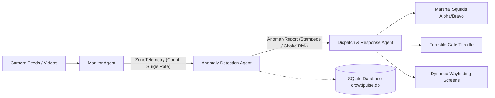

# 👥 CrowdPulse – Crowd Density Management System (SIH25165)

> **Autonomous Multi-Agent Computer Vision System for Crowd Density Monitoring, Bottleneck Detection, and Early Incident Prevention**  
> *Final Year B.Tech Project | Problem Statement: SIH25165*

---

## 📖 Executive Summary

**CrowdPulse** is a production-grade, AI-powered crowd safety platform engineered for high-density public venues (transit terminals, religious gatherings, pilgrimage sites, festival grounds, and sports stadiums). It integrates real-time YOLO computer vision, spatial grid density heatmaps, an SQLite incident audit trail, and an **autonomous multi-agent coordination architecture** (Monitor $\to$ Anomaly Detector $\to$ Dispatch Commander) to prevent stampedes and overcrowding before disasters happen.

---

## 🏆 Project Achievements Across All 4 Phases

| Phase | Milestone & Capabilities | Status |
| :--- | :--- | :---: |
| **Phase 1** | Foundation, Modular Directory Structure, Environment Diagnostics, Baseline UI Skeleton | ✅ **Completed** |
| **Phase 2** | Computer Vision Pipeline (YOLOv8n), 1,198-Image Dataset Benchmark Loader, Real-time CCTV Streamer | ✅ **Completed** |
| **Phase 3** | 2D Gaussian Density Heatmaps, $4 \times 4$ Spatial Grid Bottleneck Analysis, SQLite ORM Audit Database | ✅ **Completed** |
| **Phase 4** | Autonomous Multi-Agent Coordination (Monitor, Anomaly, Dispatch Agents), Live Incident Simulator | ✅ **Completed** |
| **Testing** | Automated unit test suite with **44/44 passing tests** (`pytest -v`) | ✅ **Verified** |

---

## 🤖 Multi-Agent System Architecture (Phase 4 Core)

Rather than relying on a fragile monolithic script, CrowdPulse uses an autonomous multi-agent architecture where agents communicate via a structured JSON message bus:



1. **👁️ Monitor Agent (`agents/monitor_agent.py`):**
   - Continuously receives headcounts from YOLO detection frames.
   - Calculates instantaneous surge rates ($\Delta N / \Delta t$, people entering per minute).
   - Generates standardized `ZoneTelemetry` payloads.
2. **🧠 Anomaly Detection Agent (`agents/anomaly_agent.py`):**
   - Analyzes telemetry against safety rules:
     - **Critical Overcrowding:** Capacity $\ge 100\%$.
     - **Sudden Crowd Surge:** Influx $\ge 20$ persons/min.
     - **Static Bottlenecks:** Choke point clustering in narrow corridors or turnstiles.
   - Assigns severity (LOW, MEDIUM, HIGH, CRITICAL) and confidence percentages.
3. **⚡ Dispatch & Response Agent (`agents/dispatch_agent.py`):**
   - Formulates tactical response orders:
     - Deploys on-ground security teams (**Rapid Response Squad Alpha**, **Ushers Bravo**).
     - Meters electronic turnstiles (throttles inflow to 10 persons/min or activates emergency exit bypasses).
     - Updates public address (PA) audio systems and overhead LED wayfinding signage.

---

## 📂 Project Directory Structure

```text
CrowdPulse/
├── app.py                      # Master Streamlit dashboard (8 interactive navigation views)
├── config.py                   # Central settings, paths, density thresholds
├── requirements.txt            # Project dependencies
├── pytest.ini                  # Pytest test configuration
├── README.md                   # Comprehensive documentation & setup guide
├── .gitignore                  # Git ignore rules for venv, cache, videos, models
│
├── agents/                     # [Phase 4] Autonomous Multi-Agent System
│   ├── __init__.py
│   ├── schemas.py              # Dataclasses (Telemetry, AnomalyReport, DispatchAction, AgentMessage)
│   ├── monitor_agent.py        # Perception agent tracking headcounts & surge velocity
│   ├── anomaly_agent.py        # Security analyst classifying crowd threats
│   ├── dispatch_agent.py       # Tactical incident commander issuing countermeasures
│   └── coordinator.py          # Central message bus & scenario simulator
│
├── database/                   # [Phase 3] SQLite Database & ORM
│   ├── __init__.py
│   ├── models.py               # SQLAlchemy models (Zone, DensityLog, IncidentAlert)
│   ├── db_service.py           # Logging, querying, and alert resolution services
│   └── crowdpulse.db           # Persistent SQLite database file
│
├── detection/                  # [Phase 2 & 3] Computer Vision & Spatial Pipeline
│   ├── __init__.py
│   ├── dataset_loader.py       # Reads 1,198 images from uploaded Parquet dataset
│   ├── detector.py             # YOLOv8 person detection and HUD rendering
│   ├── heatmap.py              # 2D Gaussian density heatmaps & 4x4 spatial grid analysis
│   └── video_stream.py         # Video frame ingestion, FPS counter, synthetic CCTV
│
├── services/                   # [Phase 4] Physical Dispatch & Equipment Services
│   ├── __init__.py
│   └── dispatch_service.py     # Marshal squads tracker, turnstile gates, digital signage
│
├── Dataset_CrowdPulse/         # Uploaded crowd counting benchmark dataset (1,198 images)
│   ├── project_CrowdPulse_part_A.parquet    (182 images, test dense)
│   ├── Project_CrowdPulse_part_A_2.parquet  (300 images, train dense)
│   ├── Project_CrowdPulse_part_B.parquet    (316 images, test sparse)
│   └── Project_CrowdPulse_part_B_2.parquet  (400 images, train sparse)
│
├── models/
│   ├── .gitkeep
│   └── yolov8n.pt              # Local YOLOv8 nano model weights (~6.2 MB)
│
├── data/
│   ├── videos/.gitkeep         # Stores CCTV video clips (MP4/AVI)
│   └── datasets/.gitkeep       # Processed annotations
│
└── tests/                      # Automated test suite (44 tests)
    ├── test_setup.py           # Phase 1 configuration & environment tests (13 tests)
    ├── test_detection.py       # Phase 2 vision & video pipeline tests (8 tests)
    ├── test_phase3.py          # Phase 3 database & heatmap tests (9 tests)
    └── test_agents.py          # Phase 4 multi-agent system tests (14 tests)
```

---

## 🚀 Quick Start Guide (Windows PowerShell)

### Step 1: Open PowerShell in Project Folder
```powershell
cd C:\Users\hp\OneDrive\Desktop\CrowdPulse
```

### Step 2: Activate the Virtual Environment
```powershell
.\.venv\Scripts\Activate.ps1
```

*(If script execution is disabled on your laptop, run this once: `Set-ExecutionPolicy -ExecutionPolicy RemoteSigned -Scope Process`)*

### Step 3: Launch the Streamlit Web Application
```powershell
streamlit run app.py
```
Your browser will open automatically to **`http://localhost:8501`**.

---

## 🖥️ Interactive Dashboard Navigation Views

1. **📍 Multi-Zone Overview:** Live 4-zone dashboard (North Gate, Central Plaza, Food Concourse, South Exit) with real-time occupancy gauges and threshold lines.
2. **🤖 Multi-Agent Command Center:** 
   - Live status cards for Monitor, Anomaly, and Dispatch Agents.
   - **Incident Scenario Simulator:** Trigger synthetic crowd events (*Sudden Surge*, *Bottleneck*, *Capacity Breached*) and watch the agents formulate real-time counter-orders.
   - **Live Inter-Agent Message Bus:** Read the timestamped JSON messages passed between agents.
   - **Field Asset Tracker:** Real-time deployment status of Marshal Squads and Electronic Gates.
3. **🔥 Spatial Heatmap & Bottlenecks:** Generates continuous thermal Gaussian overlays and $4 \times 4$ spatial grid bottleneck hotspot reports.
4. **🖼️ Crowd Dataset Benchmark:** Directly inspect and benchmark YOLO on any of the 1,198 uploaded crowd images in `Dataset_CrowdPulse/`.
5. **📤 Upload Custom Image:** Upload any photo, run detection, check for spatial bottlenecks, and record the reading into the SQLite database.
6. **🎥 CCTV Video Stream:** Real-time video processing with bounding box HUD and live FPS tracking (includes built-in concourse demo).
7. **📈 Incident Logs & Analytics:** Interactive time-series trends (Plotly), live safety incident management (Acknowledge / Resolve), and CSV export.
8. **🖥️ Hardware & Environment:** System diagnostics and NVIDIA GPU acceleration status.

---

## 🧪 Automated Unit Test Verification

To run the complete test suite:
```powershell
pytest -v
```

**Results:**
```text
============================= 44 passed in 45.89s =============================
tests/test_agents.py    (14 passed) -> Monitor velocity, Anomaly rules, Dispatch orders, Coordinator, Services
tests/test_detection.py (8 passed)  -> Dataset loader, YOLO detector, Video streamer
tests/test_phase3.py    (9 passed)  -> SQLite ORM, Density logging, Alert handling, Heatmap generator
tests/test_setup.py     (13 passed) -> Config, Paths, Thresholds, Gitignores, Environment check
```

---

## ⚡ Enabling NVIDIA GPU Acceleration (Optional)

If you wish to utilize your **NVIDIA GeForce RTX 3050 Laptop GPU** for 5x–10x faster inference and model fine-tuning:
```powershell
pip install torch torchvision --index-url https://download.pytorch.org/whl/cu124
```
Our `CrowdDetector` will automatically switch from CPU to CUDA GPU with zero configuration changes!
